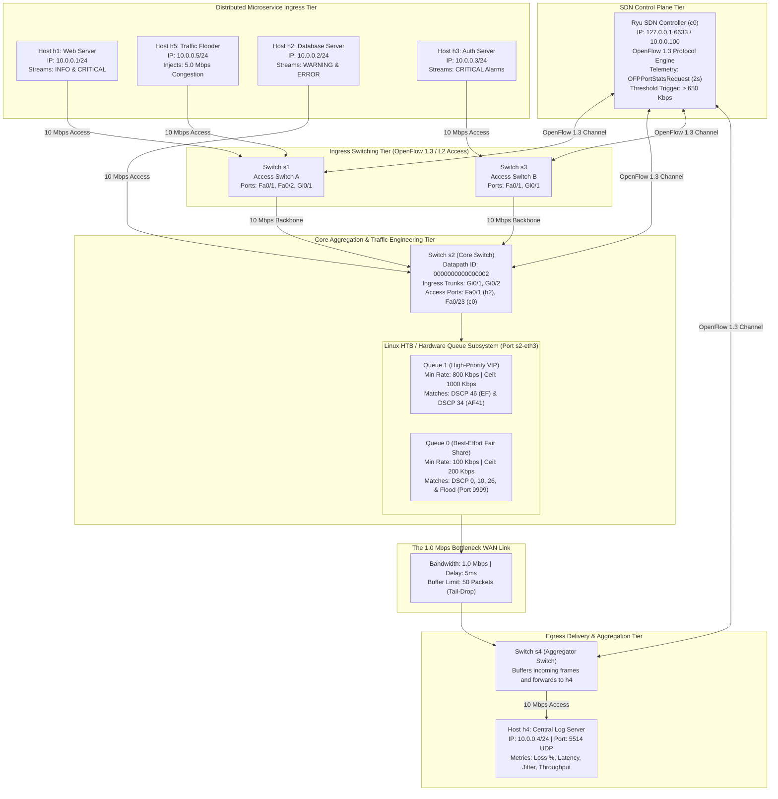

# System Architecture Specification

## Chronos: Distributed Log Aggregation System with SDN Dynamic Prioritization

---

### 1. Executive Summary & Problem Formulation

In distributed cloud architectures and microservice ecosystems, independent services continuously stream application logs, audit trails, and diagnostic traces to a centralized aggregation server for monitoring and incident response. 

```
                                      CONGESTION SCENARIO
                      +-------------------------------------------------+
                      | Aggregated Ingress Traffic: ~5.3 Mbps           |
                      |   - Microservice Logs: ~300 Kbps                |
                      |   - Background Flood Traffic: 5.0 Mbps          |
                      +-------------------------------------------------+
                                              |
                                              v
                              +-------------------------------+
                              | Bottleneck Link: 1.0 Mbps Cap |
                              | Buffer Depth: 50 Packets FIFO |
                              +-------------------------------+
                                              |
                     +------------------------+------------------------+
                     |                                                 |
                     v                                                 v
        [Traditional FIFO Queuing]                           [Chronos SDN Prioritization]
   - Indiscriminate Tail-Drop Buffer                   - OpenFlow 1.3 Dynamic Flow Steering
   - Critical Alarms Dropped (~80% loss)               - Priority Queue (Queue 1: 800k - 1M)
   - Diagnostic Blindness during Outages               - Best-Effort Queue (Queue 0: 100k - 200k)
                                                       - Result: 0% Critical Loss, Low Jitter
```

#### The Problem
During catastrophic infrastructure failures (e.g., database partition, cascading timeout, network partition), services experience a sudden surge in log volume. Concurrently, unrelated network traffic or denial-of-service surges saturate WAN transit links. Under traditional First-In, First-Out (FIFO) network queueing, intermediate switches treat every packet identically:
- Packets are dropped indiscriminately once switch buffers exceed their ceiling (tail-drop).
- High-severity alarms (e.g., `CRITICAL: Database partition detected`) are discarded at the same rate as low-priority routine diagnostic traces (`DEBUG: cache hit ratio 0.94`).
- Engineers and automated failover systems become blind to root-cause telemetry precisely when timely alerts are most critical.

#### The Chronos Solution
Chronos solves this challenge by coupling **application-level Differentiated Services (DiffServ / RFC 2474)** with **Software-Defined Networking (SDN / OpenFlow 1.3)** dynamic traffic engineering:
1. Distributed services stamp standard Differentiated Services Code Points (DSCP) into the IPv4 Type of Service (TOS) octet using low-level operating system socket calls.
2. The SDN controller continuously monitors link utilization across the switching fabric using OpenFlow port statistics telemetry.
3. When link saturation crosses an operational threshold (650 Kbps on a 1.0 Mbps bottleneck), the controller programmatically modifies OpenFlow flow tables, steering high-priority packets into dedicated hardware queues while throttling background traffic into best-effort queues.

---

### 2. End-to-End System Architecture

The following diagram illustrates the complete topology, data paths, control plane connections, and queue structures across both Mininet and physical networking layers:



---

### 3. Comprehensive Component Catalog & Technical Justification

Every host, switch, link, and software module in the Chronos architecture fulfills a specific role in modeling distributed microservice operations and network QoS.

#### 3.1 Network End-Systems (Hosts)

| Host Name | Network Address | Hardware Model | Primary Function | Technical Justification |
|---|---|---|---|---|
| [**`h1`**](file:///run/media/tin/New%20Volume/Shared/Notes/Sem%203/CN/Mini%20Project/Chronos_Log/log_client.py) | `10.0.0.1/24`<br>`MAC: 00:00:00:00:00:01` | PC-PT / Linux Namespace | **Frontend Web Microservice** | Generates high-volume informational transactions (`HTTP 200 GET`) mixed with periodic critical outage events (`Payment gateway unreachable`). Connected to `s1`. |
| [**`h2`**](file:///run/media/tin/New%20Volume/Shared/Notes/Sem%203/CN/Mini%20Project/Chronos_Log/log_client.py) | `10.0.0.2/24`<br>`MAC: 00:00:00:00:00:02` | PC-PT / Linux Namespace | **Database Cluster Node** | Generates operational warnings and database errors (`Transaction deadlock`, `Replica sync timeout`). Ingress directly at Core Switch `s2`. |
| [**`h3`**](file:///run/media/tin/New%20Volume/Shared/Notes/Sem%203/CN/Mini%20Project/Chronos_Log/log_client.py) | `10.0.0.3/24`<br>`MAC: 00:00:00:00:00:03` | PC-PT / Linux Namespace | **Authentication & Security Service** | Generates high-priority security audit logs and critical identity failures (`Security alert: multiple invalid access attempts`). Ingress at `s3`. |
| [**`h4`**](file:///run/media/tin/New%20Volume/Shared/Notes/Sem%203/CN/Mini%20Project/Chronos_Log/log_server.py) | `10.0.0.4/24`<br>`MAC: 00:00:00:00:00:04` | Server-PT / Linux Namespace | **Centralized Log Aggregator** | Listens on UDP port `5514`. De-serializes binary payloads, computes one-way transit delays, tracks sequence numbers for packet loss calculation, and records real-time jitter. |
| [**`h5`**](file:///run/media/tin/New%20Volume/Shared/Notes/Sem%203/CN/Mini%20Project/Chronos_Log/flood.py) | `10.0.0.5/24`<br>`MAC: 00:00:00:00:00:05` | PC-PT / Linux Namespace | **Congestion Generator (Flooder)** | Injects a controlled 5.0 Mbps unclassified UDP flood to destination port `9999`. Models cross-traffic, DoS bursts, or bulk backups to saturate the 1.0 Mbps bottleneck link. |
| [**`c0`**](file:///run/media/tin/New%20Volume/Shared/Notes/Sem%203/CN/Mini%20Project/Chronos_Log/sdn_controller.py) | `127.0.0.1:6633`<br>`10.0.0.100/24` | Server-PT / Ryu Process | **Ryu OpenFlow 1.3 Controller** | Houses the centralized SDN intelligence. Collects switch telemetry, evaluates queue congestion conditions, and dynamically installs priority flow rules (`OFPFlowMod`). |

---

#### 3.2 Switching Infrastructure

| Switch ID | Datapath ID | Hardware Role | Interface Configuration | Functional Responsibility |
|---|---|---|---|---|
| **`s1`** | `0000000000000001` | **Access Switch A** | - `Fa0/1` (Host `h1`)<br>- `Fa0/2` (Host `h5`)<br>- `Gi0/1` (Trunk to `s2`) | Isolates frontend clients and injects both legitimate logs and background flood traffic onto the core backbone. |
| **`s2`** | `0000000000000002` | **Core Aggregation & Bottleneck Egress Switch** | - `Gi0/1` (Trunk from `s1`)<br>- `Gi0/2` (Trunk from `s3`)<br>- `Fa0/1` (Host `h2`)<br>- `Fa0/23` (Management `c0`)<br>- `Fa0/24` (**Bottleneck to `s4`**) | **The primary enforcement point**. Aggregates all incoming microservice flows. Hosts the OpenFlow meters, Linux HTB hardware queues, and MQC QoS classification policies. |
| **`s3`** | `0000000000000003` | **Access Switch B** | - `Fa0/1` (Host `h3`)<br>- `Gi0/1` (Trunk to `s2`) | Provides edge access for the security/auth tier, demonstrating multi-switch traffic aggregation converging on the core. |
| **`s4`** | `0000000000000004` | **Egress Aggregation Switch** | - `Fa0/24` (Trunk from `s2`)<br>- `Fa0/1` (Destination to `h4`) | Terminates the bottleneck link and forwards prioritized frames directly to the central log server `h4`. |

---

#### 3.3 Link Dimensions & Bandwidth Design

| Link Segment | Endpoints | Configured Bandwidth | Propagation Delay | Queue Discipline & Buffer Limit | Architectural Justification |
|---|---|---|---|---|---|
| **Access Links** | `h1-s1`, `h5-s1`<br>`h2-s2`, `h3-s3`<br>`s4-h4` | 10.0 Mbps | 1.0 ms | Unlimited / Interface Default | Simulates high-speed local data center top-of-rack (ToR) switching links where edge drops do not occur. |
| **Backbone Trunks** | `s1-s2`<br>`s3-s2` | 10.0 Mbps | 2.0 ms | Unlimited / Interface Default | High-speed transit backbone ensuring congestion occurs solely at the designated bottleneck interface. |
| **Bottleneck Link** | **`s2-s4`** | **1.0 Mbps** | **5.0 ms** | **Strict 50-packet FIFO (Tail-Drop)** | Mathematically models wide-area network (WAN) or inter-datacenter link saturation. Capping at 1.0 Mbps with a 50-packet buffer ensures that the 5.0 Mbps flood reliably forces queue tail-drop without demanding excessive local CPU/memory during live demonstrations. |

---

### 4. Software Architecture & Implementation Modules

The Chronos codebase is modularized across low-level networking, protocol encoding, kernel traffic shaping, and SDN control:

```
Chronos_Log/
├── protocol.py            # Protocol definitions, DiffServ DSCP bit shifting, and serialization
├── log_client.py          # POSIX UDP socket client with kernel setsockopt(IP_TOS) tagging
├── log_server.py          # Asynchronous UDP server, sequence tracking, and latency computation
├── flood.py               # UDP throughput flooder for controlled congestion injection
├── sdn_controller.py      # Ryu OpenFlow 1.3 controller with dynamic telemetry and flow mod
├── setup_qos.sh           # Linux tc / HTB queue creation on Open vSwitch egress interfaces
├── topology.py            # Mininet OpenFlow 1.3 network construction script
├── main.py                # Standalone master orchestrator running the 5-phase evaluation
├── test_suite.py          # Comprehensive test suite (9 automated unit/integration tests)
├── analyze_results.py     # Log post-processing, statistical aggregation, and graph generation
└── cisco_packet_tracer/   # Turnkey Cisco Packet Tracer .pkt files and Cisco IOS MQC scripts
```

#### 4.1 Protocol Engineering ([`protocol.py`](file:///run/media/tin/New%20Volume/Shared/Notes/Sem%203/CN/Mini%20Project/Chronos_Log/protocol.py))
- **DiffServ Bit Shifting**: The IPv4 Type of Service (TOS) field reserves the upper 6 bits for the Differentiated Services Code Point (DSCP) and the lower 2 bits for Explicit Congestion Notification (ECN). To correctly mark the IP header, DSCP values must be left-shifted by 2 bits:
  $$\text{TOS} = \text{DSCP} \ll 2$$
- **Precomputed Values**:
  - `CRITICAL`: DSCP 46 (Expedited Forwarding / EF) $\rightarrow$ $\text{TOS} = 46 \ll 2 = 184\ (0\text{xB8})$.
  - `ERROR`: DSCP 34 (Assured Forwarding / AF41) $\rightarrow$ $\text{TOS} = 34 \ll 2 = 136\ (0\text{x88})$.
  - `WARNING`: DSCP 26 (Assured Forwarding / AF31) $\rightarrow$ $\text{TOS} = 26 \ll 2 = 104\ (0\text{x68})$.
  - `INFO`: DSCP 10 (Assured Forwarding / AF11) $\rightarrow$ $\text{TOS} = 10 \ll 2 = 40\ (0\text{x28})$.
  - `DEBUG`: DSCP 0 (Best Effort / CS0) $\rightarrow$ $\text{TOS} = 0 \ll 2 = 0\ (0\text{x00})$.
- **Payload Schema**: Compact JSON payload structure including `seq`, `timestamp` (sub-millisecond precision), `severity`, `host`, and `message`.

#### 4.2 Socket Layer Transmission ([`log_client.py`](file:///run/media/tin/New%20Volume/Shared/Notes/Sem%203/CN/Mini%20Project/Chronos_Log/log_client.py))
- Directly calls the operating system socket API:
  ```python
  sock = socket.socket(socket.AF_INET, socket.SOCK_DGRAM)
  sock.setsockopt(socket.IPPROTO_IP, socket.IP_TOS, tos_val)
  sock.sendto(payload, (server_ip, server_port))
  ```
- Ensures hardware switches and kernel network stacks inspect native packet header fields without inspecting payload contents (zero Deep Packet Inspection overhead).

#### 4.3 High-Performance Ingestion ([`log_server.py`](file:///run/media/tin/New%20Volume/Shared/Notes/Sem%203/CN/Mini%20Project/Chronos_Log/log_server.py))
- Configures a large kernel socket buffer (`SO_RCVBUF = 1MB`) to prevent receiver-side drops.
- Performs real-time sequence gap detection to count dropped packets per severity level.
- Computes transit latency ($T_{\text{receive}} - T_{\text{transmit}}$) and inter-packet arrival jitter ($|D_i - D_{i-1}|$).

#### 4.4 SDN Control Plane ([`sdn_controller.py`](file:///run/media/tin/New%20Volume/Shared/Notes/Sem%203/CN/Mini%20Project/Chronos_Log/sdn_controller.py))
- Implements an asynchronous event loop based on Python `eventlet`.
- Issues periodic `OFPPortStatsRequest` every 2.0 seconds to switch `s2`.
- Calculates instantaneous throughput:
  $$\text{Throughput (bps)} = \frac{(\text{tx\_bytes}_{t_2} - \text{tx\_bytes}_{t_1}) \times 8}{t_2 - t_1}$$
- When throughput exceeds 650 Kbps, the controller constructs and pushes OpenFlow flow modification messages (`OFPFlowMod`):
  - Rule 1: `match(eth_type=0x0800, ip_proto=17, ip_dscp=46) -> SetQueue(1)` (Priority 100)
  - Rule 2: `match(eth_type=0x0800, ip_proto=17, ip_dscp=34) -> SetQueue(1)` (Priority 100)
  - Rule 3: `match(eth_type=0x0800, ip_proto=17, ip_dscp=0)  -> SetQueue(0)` (Priority 100)
  - Rule 4: `match(eth_type=0x0800, ip_proto=17, udp_dst=9999) -> SetQueue(0)` (Priority 110)

#### 4.5 Kernel Queuing Subsystem ([`setup_qos.sh`](file:///run/media/tin/New%20Volume/Shared/Notes/Sem%203/CN/Mini%20Project/Chronos_Log/setup_qos.sh))
- Utilizes Linux Traffic Control (`tc`) to attach an Open vSwitch HTB qdisc to `s2-eth3`:
  - **Class `1:10` (Queue 1)**: `rate 800kbit ceil 1000kbit prio 1`
  - **Class `1:20` (Queue 0)**: `rate 100kbit ceil 200kbit prio 2`
- Guarantees that critical alarms cannot be starved by best-effort flood traffic, while capping best-effort streams to prevent buffer exhaustion.

---

### 5. Separation of Network Planes

The Chronos architecture strictly separates operational concerns into three distinct planes:

```
+-------------------------------------------------------------------------+
|                         MANAGEMENT PLANE                                |
|  - main.py orchestrator                                                 |
|  - analyze_results.py reporting and CSV generation                      |
|  - Operator CLI dashboards and test suites                              |
+-------------------------------------------------------------------------+
                                     |
                                     v
+-------------------------------------------------------------------------+
|                          CONTROL PLANE                                  |
|  - Ryu SDN Controller process (sdn_controller.py)                       |
|  - OpenFlow 1.3 Channel (TCP 6633)                                      |
|  - Port statistics telemetry collection & threshold evaluation          |
|  - Flow table rule synthesis (OFPFlowMod)                               |
+-------------------------------------------------------------------------+
                                     |
                        OpenFlow 1.3 | Southbound API
                                     v
+-------------------------------------------------------------------------+
|                           DATA PLANE                                    |
|  - Open vSwitch (OVS) kernel forwarding datapath                        |
|  - Linux Hierarchical Token Bucket (HTB) hardware queues               |
|  - Line-rate frame forwarding based on flow table lookups               |
|  - Zero CPU intervention for packets matching established flow rules     |
+-------------------------------------------------------------------------+
```

---

### 6. Dual-Track Implementation: Mininet vs. Cisco Packet Tracer

To satisfy both software programming requirements and networking hardware design requirements, Chronos provides exact functional parity between Mininet and Cisco Packet Tracer:

| Architectural Concept | Mininet + Ryu SDN Track (Primary) | Cisco Packet Tracer Track (Supplementary) |
|---|---|---|
| **Underlying Switch Engine** | Open vSwitch (`OVSSwitch`, OpenFlow 1.3 datapath) | Cisco Catalyst `2960-24TT` / `3560-24PS` Switches |
| **Control Plane Logic** | Dynamic Ryu Controller (`sdn_controller.py`) pushing rules via telemetry trigger (> 650 Kbps) | Cisco Modular QoS CLI (MQC) static hardware policies |
| **QoS Rule Syntax** | `OFPFlowMod(match=ip_dscp=46, actions=[SetQueue(1)])` | `class-map CM_CRITICAL_LOGS` / `match access-group 100` |
| **Queue Scheduling** | Linux Kernel Hierarchical Token Bucket (`tc / HTB`) | Hardware Priority Queuing (PQ) + CBWFQ |
| **High-Priority Channel** | Queue 1: `rate 800kbit ceil 1000kbit prio 1` | `policy-map PM_CHRONOS_SDN_QOS` $\rightarrow$ `priority 800` |
| **Best-Effort Channel** | Queue 0: `rate 100kbit ceil 200kbit prio 2` | `policy-map PM_CHRONOS_SDN_QOS` $\rightarrow$ `bandwidth 200` |
| **Packet Tagging Mechanism** | `sock.setsockopt(socket.IPPROTO_IP, socket.IP_TOS, val)` | Complex PDU Tool entering `TOS = 184 (0xB8)` |
| **Congestion Source** | `flood.py` injecting 5.0 Mbps dummy UDP payload | High-frequency periodic PDU generation tool |
| **Bottleneck Modeling** | `TCLink` capped at 1.0 Mbps, 5ms delay, 50-packet FIFO | `interface Fa0/24` forced to `speed 10 duplex full` |

---

### 7. Execution Life-Cycle (The 5 Demonstration Phases)

When executing [`main.py`](file:///run/media/tin/New%20Volume/Shared/Notes/Sem%203/CN/Mini%20Project/Chronos_Log/main.py), the system progresses through 5 phases:

```
Phase 1: Boot & Verification
  - Central Log Server initializes on 10.0.0.4:5514
  - End-to-end socket reachability verified

Phase 2: Baseline Microservice Streaming
  - h1, h2, h3 stream mixed severity logs (~250-300 Kbps)
  - Buffer occupancy remains near 0%; 100% packet delivery across all severities

Phase 3: Cross-Traffic Congestion & FIFO Tail-Drop
  - h5 injects 5.0 Mbps flood traffic across the 1.0 Mbps bottleneck
  - Buffer overflows 50-packet limit; FIFO drops packets indiscriminately (~80% loss)
  - Critical alarms and error messages are dropped alongside debug logs

Phase 4: SDN Dynamic QoS Intervention
  - Ryu controller detects throughput > 650 Kbps
  - OpenFlow flow rules installed steering DSCP 46/34 to Queue 1, DSCP 0 to Queue 0
  - High-priority traffic bypasses the congested best-effort queue

Phase 5: Performance Recovery & Metrics Matrix
  - CRITICAL loss drops from ~80% to 0.0%
  - Best-effort flood traffic absorbs the bulk of queue drops (~85% dropped)
  - System generates performance comparison report and telemetry CSV
```

---

### 8. Viva Defense & Key Technical Answers

#### Q1: Why did you use UDP instead of TCP for log streaming?
*Answer*: In distributed logging, log generation must be **non-blocking and decoupled** from receiver availability. If TCP were used, backpressure or head-of-line blocking during a network bottleneck would stall application execution threads waiting for TCP ACKs. UDP allows microservices to emit telemetry asynchronously at line rate. Priority enforcement is then handled by the network infrastructure (SDN/QoS) rather than transport layer retransmissions.

#### Q2: Why is the TOS value shifted by 2 bits (`dscp << 2`)?
*Answer*: According to RFC 2474, the IPv4 Type of Service octet assigns the high-order 6 bits to the Differentiated Services Code Point (DSCP) and the low-order 2 bits to Explicit Congestion Notification (ECN). To pass a 6-bit DSCP (such as EF = 46 or binary `101110`) to the operating system's `IP_TOS` socket option, the value must be left-shifted by 2 bits (`46 << 2 = 184` or hex `0xB8`), placing the DSCP bits into bit positions 2 through 7.

#### Q3: How does the SDN Controller know when to install QoS rules?
*Answer*: The controller runs an asynchronous monitoring loop that issues standard `OFPPortStatsRequest` messages to Core Switch `s2` every 2.0 seconds. By calculating the delta of transmitted bytes over time ($\Delta \text{Bytes} \times 8 / \Delta t$), the controller computes real-time egress throughput on bottleneck port `s2-eth3`. When utilization exceeds the 650 Kbps threshold, the controller pushes proactive `OFPFlowMod` match-action rules matching DSCP tags to specific hardware queue IDs.
